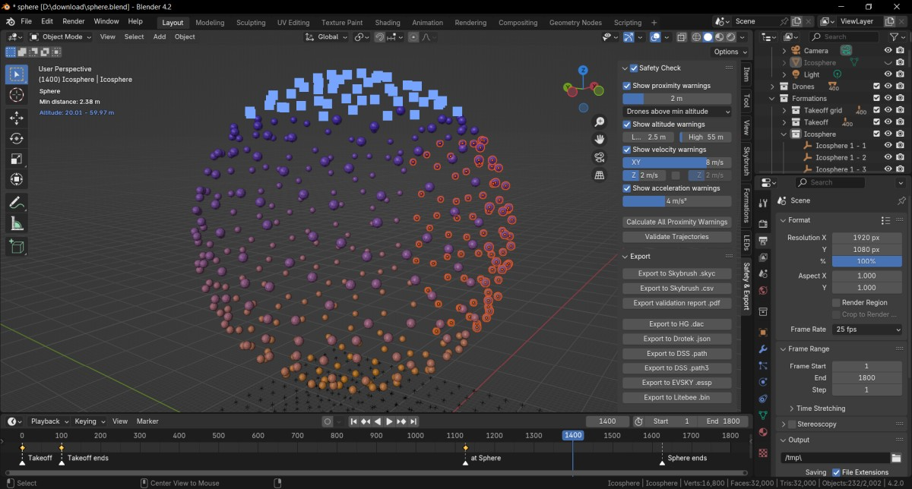

# Skybrush Studio for Blender



This repo contains [Skybrush Studio for Blender](https://skybrush.io),
a professional drone show designer framework integrated into
[Blender](https://blender.org).

The output of Skybrush Studio for Blender is a single `.skyc` file, which
contains the trajectories and light programs for all the drones in the show.
Using `.skyc` files together with the [Skybrush suite](https://skybrush.io)
allows you to preview, validate, verify, analyze, plot and execute drone shows
with a few clicks.

## Installation

[Skybrush Studio for Blender](https://skybrush.io) is distributed as a
ZIP file that can be installed in Blender according to the official
[Blender add-on guide](https://docs.blender.org/manual/en/latest/editors/preferences/addons.html).
However, this repository does not contain the ZIP version of the plugin or the
standalone executables but the _source code_ of the plugin. Therefore, in order
to create the ZIP version and the executables on your own, you either need to
[download it from us](https://skybrush.io) or [build the ZIP
yourself](#building-the-plugin). Once you obtained the ZIP version of the
plugin, follow the installation guide in our [online
documentation](https://doc.collmot.com/public/skybrush-studio-for-blender/latest/install.html)

## Building the plugin

The build process is tested on macOS at the moment. It is very likely to work
on Linux as well. On Windows, you can try building inside Cygwin or Windows
Subsystem for Linux; the build script is written in `bash` so you will
definitely need an environment that provides `bash`.

The build script can be executed as follows:

```sh
bash etc/scripts/create_blender_dist.sh
```

When successful, the script creates the ZIP bundle of the addon in the `dist/`
folder.

## Development

If you want to modify the plugin and add your own functionality, the easiest is
to set up a folder that can be used directly as an entry in the Blender addon
path. This way you can modify the source code of the plugin without having to
build a ZIP after every modification.

First, run `uv install` in the root folder of the repository to install the
dependencies of the plugin.

Next, on Linux or macOS, you can run `etc/scripts/bootstrap.sh` to create a folder
named `dev/` within the repository. This folder sets up symbolic links in a
way that allows you to load the plugin directly if you add the `dev/` folder to
your Blender addon path. On Windows, you can achieve the same thing by running
`etc/scripts/bootstrap_windows.bat`.

Note that you might still need to exit Blender and restart it again if you
make a modification to the plugin code to ensure that your modifications are
picked up by Blender.

## Support

For any support questions please contact us on our [Discord server](https://skybrush.io/r/discord).

## License

Copyright 2020-2025 CollMot Robotics Ltd.

Skybrush Studio for Blender is free software: you can redistribute it and/or
modify it under the terms of the GNU General Public License as published by the
Free Software Foundation, either version 3 of the License, or (at your option)
any later version.

Skybrush Studio for Blender is distributed in the hope that it will be useful,
but WITHOUT ANY WARRANTY; without even the implied warranty of MERCHANTABILITY
or FITNESS FOR A PARTICULAR PURPOSE. See the GNU General Public License for
more details.

You should have received a copy of the GNU General Public License along with
this program. If not, see <https://www.gnu.org/licenses/>.

## Utility script: light effect preset GIF previews

The repository also contains `etc/scripts/render_light_effect_preset_gifs.py`,
a helper script that renders animated GIF previews for all built-in light
effect presets.

The script evaluates each preset on a sunflower-seed drone layout and saves one
GIF per preset. It also supports options for the output folder, drone count,
and whether a connector line should be drawn between consecutive drones.

Example usage:

```sh
uv run --with pillow python etc/scripts/render_light_effect_preset_gifs.py
```

For instance, to render previews for 100 drones into `tmp/light-effect-gifs/`
and draw the connector line:

```sh
uv run --with pillow python etc/scripts/render_light_effect_preset_gifs.py \
  --output-dir tmp/light-effect-gifs \
  --drone-count 100 \
  --draw-connector-line
```

## Non-numba branch integration

The local `merge/non-numba` branch integrates these source tips:

- `main`: `0f2a048`
- `led`: `554f32a`
- `feat/video-led-projection`: `29e7d35`

The `numba` branch is excluded. The lighting sidebar now has two panels:

- **LED**: ordinary primary/secondary color picking, color keyframes and UV sampling.
- **灯效 (Effects)**: one list containing video projection, ramps, images, presets
  and Python effects. Add either a procedural or video row, then use the same
  enable, duplicate, remove and reorder actions. Lower rows overlay upper rows,
  so videos and procedural effects can be interleaved. The master switch, timing,
  fade, influence and blend mode apply to both kinds of effect.

Markers, evaluated material colors, and MAT samples share the final-color
evaluator. Invalid effects are reported in preview and stop MAT sampling;
sampling restores the original frame on both success and failure.

Older scene video settings migrate into the shared list on load/registration.
Procedural rows keep their order; legacy video rows are appended in reverse
order to preserve their former priority above procedural effects. Migrated scene
Action-slot/NLA F-Curves and drivers retain their video property bindings.
Legacy RNA fields remain available only for migration. JSON includes video
projection settings and asset references; missing video textures/target objects
are reported and imported disabled rather than silently widening their scope.
Video-specific JSON rows are a DroneAnim extension, not a Skybrush interchange
format guarantee.

Run the isolated integration check on Windows:

```powershell
& 'C:/Program Files/Blender Foundation/Blender 5.2/blender.exe' --background --factory-startup --python-exit-code 1 --python test/blender_non_numba_merge_smoke.py
& 'C:/Program Files/Blender Foundation/Blender 5.2/blender.exe' --background --factory-startup --python-exit-code 1 --python test/blender_unified_lights_smoke.py
# In a Python environment containing NumPy, SciPy and pytest:
python test/verify_non_numba_mat.py
$env:PYTHONPATH = 'src/modules'
python -m pytest test
```

The Blender check uses synthetic decoded video pixels to verify projection,
composition, target scope, frame boundaries, preview/sample consistency, scene
restoration, deterministic samples, and registration lifecycle. It writes two
MAT fixtures and a JSON report under the ignored `tmp/non-numba-merge/` folder;
the separate SciPy reader checks their keys, dtypes, dimensions, row order,
world positions, finite values, endpoints and colors (absolute tolerance 1e-6).

Native movie decoding and interactive video export still require Blender's GUI
and are not established by this background test. The current legacy MAT schema
is preserved (`x`, `y`, `z`, `r`, `g`, `b`: double matrices, drones by samples;
`Qn`: zero-based double row indices). This merge does not migrate it to the
planned canonical `t`/`id`/`xyz`/`rgb` contract or establish flight safety.

Validation on Blender 5.2.1 LTS: the isolated integration smoke test and independent
SciPy MAT round trip passed; the repository suite passed all 131 tests. The additional unified-list smoke test covers mixed reordering,
blend strength, enable/disable, duplicate/delete, video looping, JSON round trips,
invalid-input rejection, two-panel draw paths, idempotent legacy migration and
keyframe path conversion. The safety
math test loader now provides package context for its relative imports without
importing Blender. Changed Python sources also passed `py_compile`.
